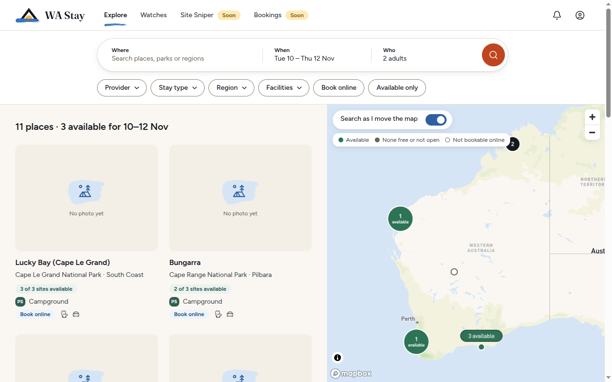
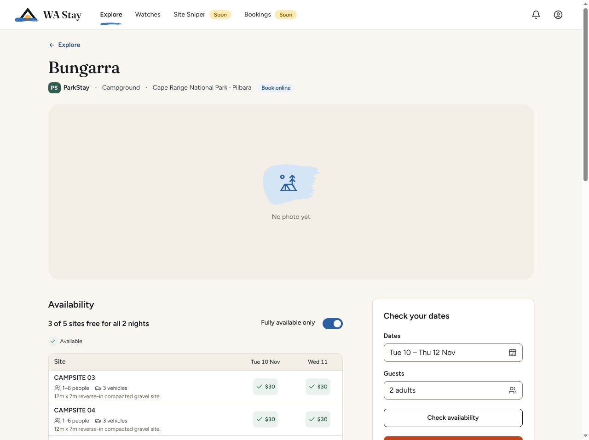
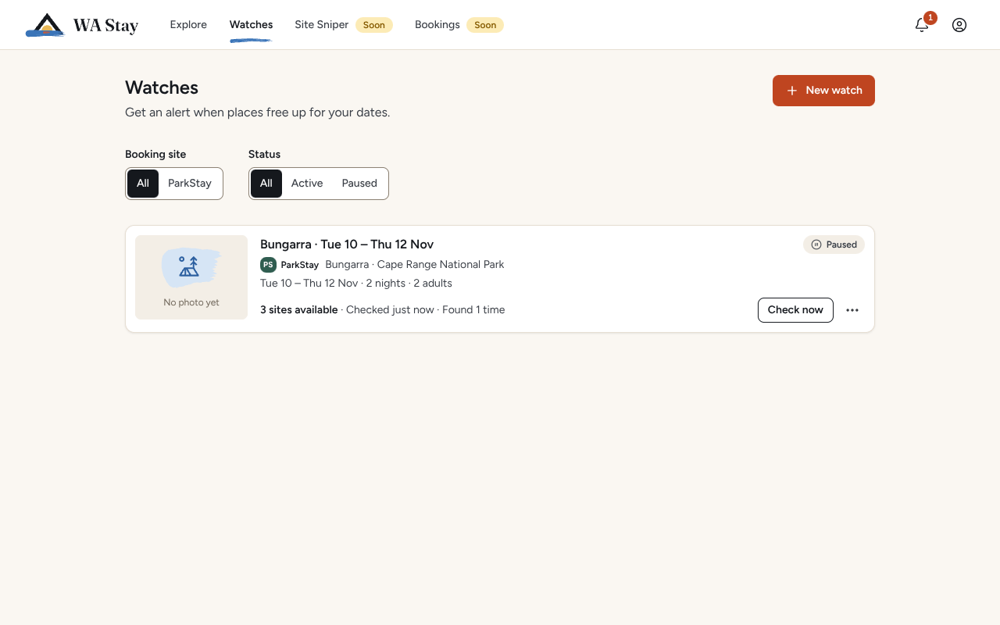

# User guide

WA Stay helps you find places to stay across Western Australia and get them when they are
hard to book. It works with **providers**, the booking systems that own the places. Two are
built in: **ParkStay WA**, DBCA's booking system for national-park campgrounds, and **RAC Parks &
Resorts**, RAC's holiday parks and resorts, from Esperance to Broome.

New to WA Stay? Install it first ([installation](installation.md)). Upgrading from the old 1.x
app? Your data moves over by itself ([upgrading](installation.md#upgrading-from-wa-parkstay-bookings)).

## Contents

- [Finding your way around](#finding-your-way-around)
- [Explore](#explore)
- [A place's page](#a-places-page)
- [Watches](#watches)
- [Site Sniper (coming soon)](#site-sniper-coming-soon)
- [Bookings (coming soon)](#bookings-coming-soon)
- [Notifications](#notifications)
- [Settings](#settings)
- [Good to know](#good-to-know)

## Finding your way around

There is no login: WA Stay opens on **Explore**. The top navigation has **Explore**,
**Watches**, **Site Sniper** and **Bookings**; the last two carry a **Soon** pill because they
are still being finished, but you can use them. On the right are the **notifications bell** and
the **account menu**, which opens **Settings**.

Everything shows which provider it belongs to: a small coloured badge with the provider's
monogram (ParkStay's is "PS" on green, RAC's "RAC" on dark grey).

## Explore

- **Search.** The pill at the top takes **Where** (a place, park or region), **When** (your
  dates) and **Who** (guests). Results update as you type.
- **Filters.** **Provider**, **Stay type** (Camping, Cabins & villas, Rooms, Dorms, Glamping:
  places with any you tick), **Region**, **Facilities**, **Book online** and, once you have
  dates, **Available only**.
- **Availability.** With dates, every card and map pin shows how many sites are free for your
  whole stay ("2 of 3 sites available", "No site free every night", "Info only" for places
  that are not booked online), and the heading counts the places available. RAC's parks say
  how many are free ("27 spots free", "1 cabin free"), as RAC gives no total, or "Not open"
  when nothing can be booked for those dates yet. With a stay type ticked, a place that also
  has other kinds counts only the ones you chose, or says "Check dates on the place page" when
  its provider doesn't count them separately.
- **The map** shows every place from every provider. With **Search as I move the map** on, the
  list narrows to the area you are looking at. Pins cluster when zoomed out; the key explains
  the colours. If WA Stay was built without a map token, Explore shows the list only and says
  so.
- The list is ordered by distance from the middle of the map. Your search, filters, dates and
  map position are in the page address, so Back takes you where you were.

Places and photos come live from the provider. The catalogue is refreshed once a day and works
offline in between; availability needs a connection.

### Why do RAC's counts take a minute?

RAC can't be asked about every park at once, and its site asks automated tools to pause
between requests, so WA Stay asks about one park at a time. With your dates, ParkStay's counts
arrive at once, while RAC's eight parks take about 40 to 60 seconds together (each answer
takes a few seconds); Explore says "Still checking RAC…" until they arrive. What you start
yourself (your dates on Explore, a place's **Check availability**, a watch's **Check now**)
goes first, a second after the request before it. Watches and snipes check in the background,
at least 10 seconds apart, so they never hold up what you are looking at for more than one
request.

## A place's page

Click a place to open its page:

- the provider, the type of place, the park and region, photos and the provider's description,
  and under **Booking rules** when new dates open (at an RAC park: "New dates open daily at
  midnight AWST, 364 days ahead. School holidays open on RAC's release days at 8 am AWST, 48
  hours earlier for members.");
- **Check your dates**: pick dates and guests and **Check availability** to see every site
  (or cabin, room…) night by night, with prices ("3 of 5 sites free for all 2 nights"; **Fully
  available only** narrows the table), and under each one's name how many people and vehicles
  it takes and the provider's description of it. A price from a special rate says so under the
  name: with your RAC member number saved, RAC's members' rates count, marked "Rate: RAC member
  rate". A night the provider refuses for your stay (a minimum stay, a day with no arrivals) is
  marked, with the reason;
- **Book on {provider}** opens the provider's booking page in your browser with this place and
  your dates chosen: ParkStay's search page, whose **See availability** takes you on to book,
  or the RAC park's booking page. With an RAC member number saved, **Copy RAC member number**
  sits beside it, for RAC's checkout;
- **Watch for availability** starts a watch for this place and these dates;
- **Snipe a site** (or a cabin, a room…: the place's own word) starts a Site Sniper snipe;
- **View on {provider}** and **More information** open the provider's pages in your browser.

## Watches

A watch checks a place for your dates on a schedule and tells you when sites free up.

1. **New watch** (or **Watch for availability** on a place's page).
2. Choose the provider, the place and your stay: dates, guests, the provider's own fields
   (ParkStay's **Camping with**, RAC's **Pets**, up to 2), the stay type at a place with more
   than one (camping, cabins…), the sites you prefer (or any) and an optional maximum price per
   night. A warning says when your stay is shorter than the place usually takes: WA Stay alerts
   only on stays the provider accepts.
3. Choose the alerts: how often to check (every 15 minutes to daily; 1 hour by default; a
   provider may set a longer minimum), whether to tell you about partial availability (only
   some nights free), whether to stop after the first alert, and, for ParkStay (and RAC with
   its experimental auto-cart turned on), **Hold a site automatically when found**.
4. Review and **Create watch**.

Each watch shows its last result, when it last checked and next checks, and how many times it
has found something. **Check now** checks at once. The menu lets you edit, pause or resume, and
delete it. Filter the list by provider and by status (active or paused).

A watch that holds a site shows **Pay now**: see [Site Sniper](#when-a-site-is-held). More
detail: [Watches and notifications](watches-and-notifications.md).

### What happens when I click an alert?

For every provider, clicking a desktop alert that a watch found something opens the watch in WA
Stay and the provider's booking page in your browser, filled in with the place and the dates it
found (for some nights free, the longest run of them). Book there before someone else does: an
alert reserves nothing. The watch's page has the same **Book on {provider}** link under its
last result while the stay is still ahead. An alert that a site is **held** opens only the
watch, where you pay.

### Can I book from my phone?

Yes, from the email. With email alerts on ([Settings](#settings)), each alert that a watch found
something has a **Book on {provider}** link to the provider's public booking page for those
dates, so you can book from your phone or any other computer. The link is always a page on the
provider's own site, never a cart or a checkout. An email about a held site says the hold is in
WA Stay on the computer that placed it (pay there), and gives the same public link.

## Site Sniper (coming soon)

Site Sniper catches a hard-to-get site the moment it is released, checks rapidly across the
release, and then does what you chose under **When the dates are free**:

- **Alert me** sends a desktop alert and an email with a link to book on the provider's site,
  and holds nothing, so book it before someone else does. Clicking the alert opens the snipe and
  the provider's booking page, filled in with your stay.
- **Hold it for me** places a hold that you then pay for, where the provider places holds
  (ParkStay's 30-minute hold, its default). A provider that places no holds offers alerts only.

When the dates are released depends on the provider:

- **ParkStay WA:** when a new date opens (180 days ahead, at the campground's release time), at
  a scheduled block release, or when someone cancels. Site Sniper joins the DBCA queue when the
  release uses it.
- **RAC Parks & Resorts** (alerts, unless you turn on its experimental auto-cart, below): when
  your dates open, at midnight Perth time 364 days
  ahead; for WA school holidays, on RAC's own release days at each park's hour (7, 8 or 9 am),
  and with your RAC member number saved, at the members' pre-sale, 48 hours before everyone
  else; or at a time you set, for dates RAC releases on days of its own (Cable Beach's dry
  season). An RAC snipe checks every 10 seconds at most, for at most 30 minutes. When WA Stay
  can't work out the release (school holidays RAC hasn't announced, dates already open), it
  says why and suggests a watch or a time you set.

**New snipe** walks through the provider, the place, your stay (with ParkStay's vehicles and
postcode, RAC's pets, and the stay type at a place with more than one), when the sites are
released, and a review. Snipe only what you will use. Full guide:
[Site Sniper](site-sniper.md).

### When a site is held

You get a notification, and the snipe (or watch) shows "<site> is held for you", the time it is
held until and a countdown of the time left to pay ("Held until 10:42 am AWST · 23:10 left").
A watch and a snipe show the same panel.

1. **Pay now** opens ParkStay's payment page in its own window. If the DBCA queue is busy,
   WA Stay first gets you through it.
2. Sign in there if ParkStay asks; the held site stays in your basket.
3. Pay on ParkStay's pages. WA Stay never sees your card.
4. When ParkStay confirms this booking, the snipe or watch shows **Booked** and the booking
   appears under Bookings.

With RAC's auto-cart turned on (an experiment, below), a held RAC stay is in your RAC cart:
**Pay now** opens RAC's cart page, where you check out and pay yourself, with **Copy RAC member
number** beside it for RAC's member prompt. The hold lasts as long as RAC's cart says, or about
10 minutes when it doesn't say. **Let it go** (or closing the window without paying) takes the
stay out of the cart. WA Stay doesn't mark an RAC stay **Booked**: look for RAC's confirmation
email.

## Bookings (coming soon)

Bookings keeps your trips from every provider in one place, in **Upcoming**, **Past** and
**Cancelled** tabs, with search and a provider filter.

- Bookings paid through WA Stay's payment window are added for you.
- **Add booking** records one you made elsewhere: the provider, the place, check-in and
  check-out, the unit, guests, the reference and the cost.
- A booking's page shows its details, copies the reference, and links to **Manage on
  ParkStay** to change or cancel it on ParkStay's own site.
- Importing bookings straight from a provider appears only for providers that support it;
  neither ParkStay nor RAC does yet.

## Notifications

The bell shows every notification, newest first, with an unread count; click one to open what
it is about. WA Stay also shows desktop notifications (titled with the provider, e.g.
"ParkStay · Sites available at Bungarra") and can email you. Notifications older than 30 days
are deleted automatically.

The tray at the bottom right shows the DBCA queue while WA Stay is waiting in it, and offers
app updates when one is ready.

## Settings

Open Settings from the account menu (top right).

- **Accounts.** One row per provider. **Connect** signs you in to ParkStay in an in-app
  window, on ParkStay's own pages: ParkStay emails you a code to type in. It is optional: holds
  work without it, and you can sign in on the payment page instead. Connecting before a release
  just makes checkout quicker. Got a sign-in link by email instead? Paste it under **Have a
  sign-in link?**. **Sign out** clears ParkStay's session in WA Stay and nothing else; it waits
  while a snipe or hold needs the session. [How sign-in works](providers/parkstay/authentication.md).

  RAC has no sign-in in WA Stay: its row is for your **RAC member number**, which is optional.
  **Add RAC member number**, type your own number and tick the three statements (it is your
  own number, you will stay at the park, and you will book in the name on your RAC card), then
  **Save**. WA Stay checks only that it looks like a member number (4 to 16 digits; spaces and
  hyphens are fine), keeps it encrypted on this computer, never shows it again and never sends
  it, to RAC or anyone else. The row then reads "RAC member number saved", with **Replace**,
  **Remove** and **Copy RAC member number**. With it saved:
  - RAC's members' rates count in prices (marked "Rate: RAC member rate") and in free counts,
    and stays open only to members (the school-holiday pre-sale) read as free;
  - Site Sniper times school-holiday snipes to the members' pre-sale, 48 hours before everyone
    else (not for Margaret River's dorms, which are not in it);
  - **Book on RAC** opens the book-now page as a member, and **Copy RAC member number** sits
    beside it (on a place's page, a watch and an alerted snipe), and beside **Pay now** for a
    stay in your RAC cart. You type or paste the number at RAC's own checkout, where RAC checks
    it against your name.

  Saving, replacing or removing it checks RAC's availability again. A copied number stays on
  the clipboard until you copy something else, and Windows keeps copies of what you copy if
  clipboard history (Windows key + V) or syncing across devices is on: clear it there, or turn
  them off in Windows Settings → System → Clipboard, if you share this computer.

  RAC's row also has an **Experimental** group, for what RAC's support in WA Stay ships turned
  off: **Put stays in my RAC cart automatically**. Turned on (it asks first, and warns that it
  hasn't been checked with a real booking and that a cart isn't a booking), a watch that holds
  automatically or a snipe set to **Hold it for me** puts the stay it finds in your RAC cart,
  one at a time, for you to pay on RAC's own page
  ([the auto-cart](watches-and-notifications.md#rac-the-auto-cart)). It takes effect when WA
  Stay restarts ("Turns on when WA Stay restarts" until then), and so does turning it off, which
  can't be done while an RAC snipe set to hold is running or a stay is held, being held or being let go: pay
  for it or let it go first. Once it is off, no new stay goes in the cart, even before the
  restart.

- **Notifications.** **Desktop notifications** and **Play a sound**, and **Email**: your SMTP
  settings (Gmail, Outlook or your own server), where to send alerts, and **Send test email**.
  [Email setup](watches-and-notifications.md#email).
- **App.** **Start WA Stay when you sign in** and **Start minimised** (it opens in the
  taskbar instead of on screen). Available on Windows and macOS.
- **About.** The version, **Check for updates**, **Open logs folder**, and **Technical
  details** (versions of Electron, Chrome and Node.js) for bug reports.

## Good to know

- **WA Stay checks watches and runs snipes only while it is running** (and the computer is
  awake). Closing the window quits it; turn on **Start WA Stay when you sign in** to keep it
  going.
- **Your data stays on your computer**, in `%APPDATA%\WA Stay` on Windows. Your RAC member
  number is kept there encrypted, and WA Stay never sends it. WA Stay talks to the providers
  (ParkStay, the DBCA queue, RAC) and the sites that host their photos (RAC's come from NewBook,
  its booking system), Mapbox for the map (the Mapbox map library also sends Mapbox its standard
  usage events), GitHub for updates, and your own email server if you set one up. WA Stay
  itself has no account, no cloud service and no analytics.
- **What WA Stay sends RAC, and how often.** Only what it needs for the places and dates you
  look at, watch or snipe, one request at a time: when you open a park, its book-now page (at
  Exmouth, Karri Valley and Monkey Mia, an availability request instead, which lists their
  cabins and sites), and one availability request for a park and stay. With the auto-cart
  turned on, a hold also reads the park's cart page and opens one cart address, and letting it
  go sends RAC's own "remove" request. Watches and snipes check in the
  background, at least 10 seconds apart: a watch no more often than every 15 minutes, and a
  snipe every 10 seconds for at most 30 minutes after a release. Your member number is never
  sent.
  If RAC turns a request away, WA Stay stops asking RAC for 30 minutes (longer if it happens
  again) and says when it will try again. [What WA Stay sends RAC](providers/rac/README.md#pacing).
- **Payment is always yours to make**, on the provider's own site.
- **Book responsibly with ParkStay.** One account per person, one booking per night, and only
  stays you will take. [DBCA's terms](providers/parkstay/README.md#dbcas-terms).
- **Book responsibly with RAC.** Use only your own member number, for a stay you will take,
  booked in the name on your RAC card. A member may make at most two bookings for the same
  period (their own and one for their guests, with the same dates), and a site takes at most
  two pets. [RAC's terms](providers/rac/README.md#racs-terms).
- Something not working? [Troubleshooting](troubleshooting.md).
